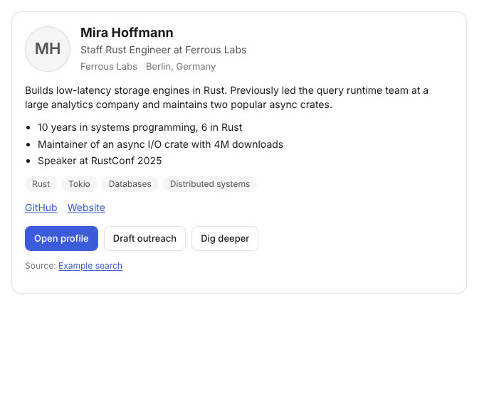

# Inkview

Agent-agnostic UI components for [MCP Apps](https://github.com/modelcontextprotocol/ext-apps).
Your agent already has the data; Inkview draws it as a native-looking component
right in the chat, in Claude, ChatGPT and any other host that renders MCP Apps.

> **Pilot (v0.1):** one component, the **profile card**. Table, result list,
> entity card, comparison, chart and product grid follow.



## How it works

Inkview is an MCP server of *render tools*. The agent gathers data with its own
tools (search, LinkedIn, CRM...), then calls `show_profile_card` with it. The
server validates the data and returns:

- `structuredContent` for the UI, which the host draws from the tool's `ui://` resource in a sandboxed iframe
- a markdown version of the same card, for the model and for text-only hosts (Claude Code, Codex CLI)

The server is stateless: it stores nothing and never logs tool arguments.

| Piece | Where |
| --- | --- |
| Component schema + markdown fallback | `src/schemas/profile-card.ts` |
| Render tool + `ui://` resource | `src/server.ts` |
| HTTP (`/mcp`) and stdio entry point | `src/main.ts` |
| React view (MCP Apps bridge, host theming) | `src/ui/` |

## Run it locally

Inkview is a stdio MCP server you start with `npx`:

```json
{ "mcpServers": { "inkview": { "command": "npx", "args": ["-y", "@feimacode/inkview"] } } }
```

Claude Desktop renders the card; Claude Code and Codex print its markdown
version. Setup for each app: **[docs/local-quickstart.md](docs/local-quickstart.md)**.

From source:

```bash
npm install          # also builds
node dist/main.js    # stdio
npm run dev          # HTTP on http://localhost:3001/mcp
```

## Claude web and ChatGPT web

These connect from the cloud, so run `npm run dev` plus a tunnel
(`npm run tunnel`) and add the public URL as a connector:
[docs/testing-in-claude-and-chatgpt.md](docs/testing-in-claude-and-chatgpt.md).

## Test

```bash
npm test     # MCP smoke test (list, call, read resource) + render test in a headless test host
```

The render test needs Playwright's Chromium (`npx playwright install chromium`).

## Configuration

| Variable | Default | Purpose |
| --- | --- | --- |
| `PORT` | `3001` | HTTP port |
| `HOST` | `127.0.0.1` | Bind address (use `0.0.0.0` in a container) |
| `INKVIEW_IMAGE_DOMAINS` | | Extra avatar image origins for the component CSP, comma separated |
| `INKVIEW_UI_DOMAIN` | | Dedicated sandbox origin, if a host asks for one |

Avatars only load from origins declared in the CSP (GitHub, LinkedIn media,
Gravatar, unavatar.io, Wikimedia, Unsplash, X/Twitter images by default).
Anything else falls back to initials.

## Roadmap

The MVP is planned as OpenSpec changes: see [docs/roadmap.md](docs/roadmap.md) and [`openspec/`](openspec).

## License

MIT
