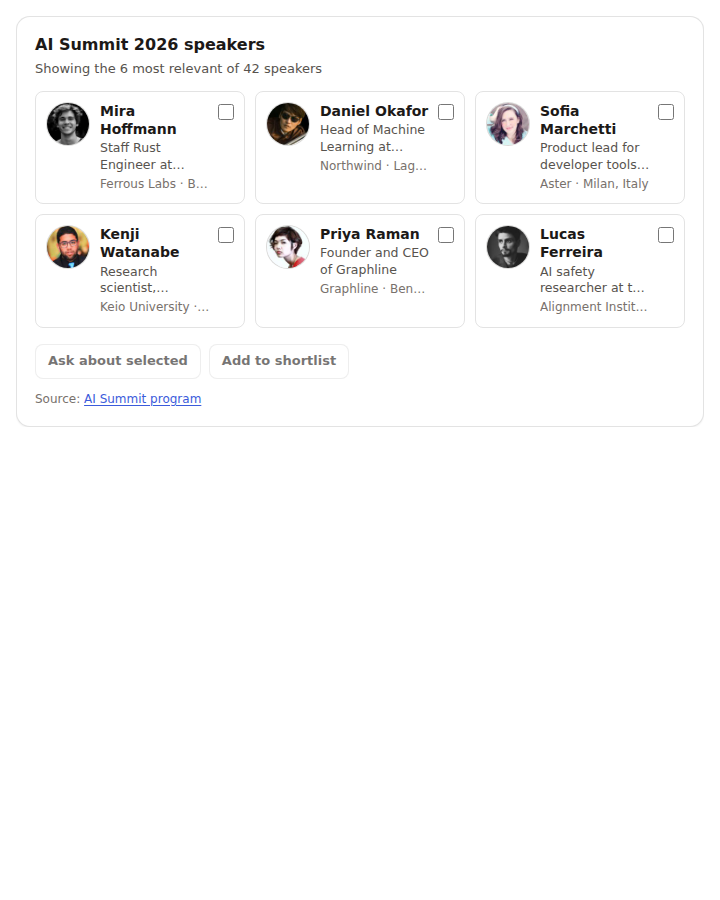
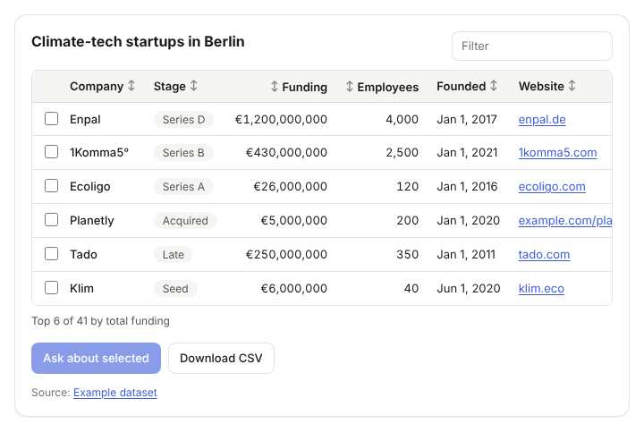
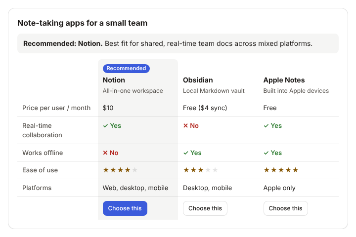
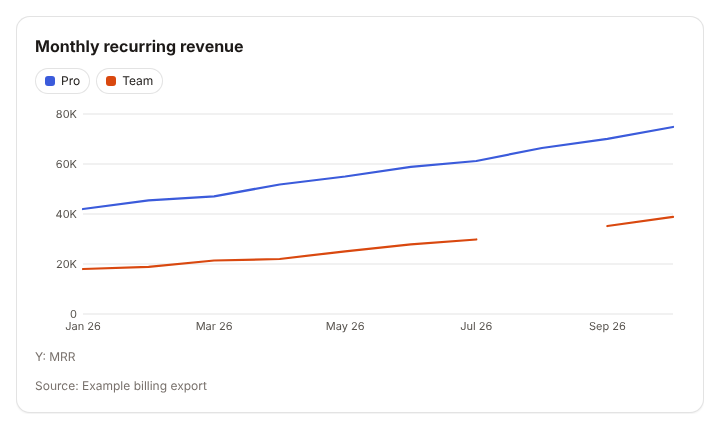
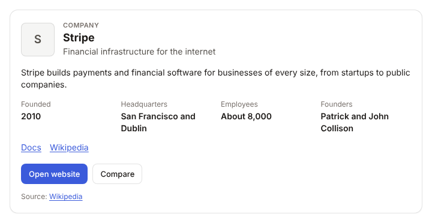
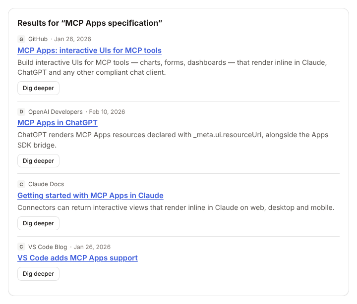
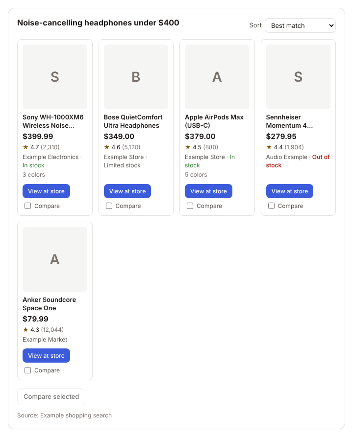
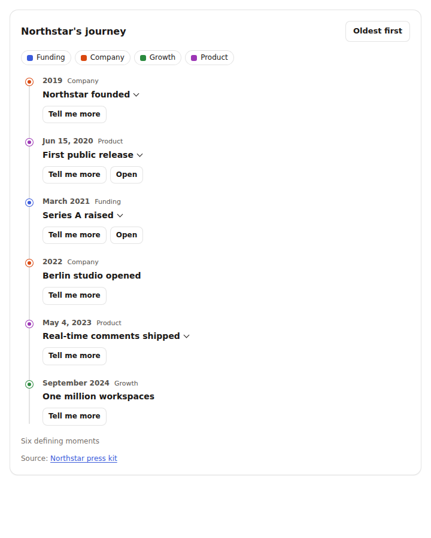
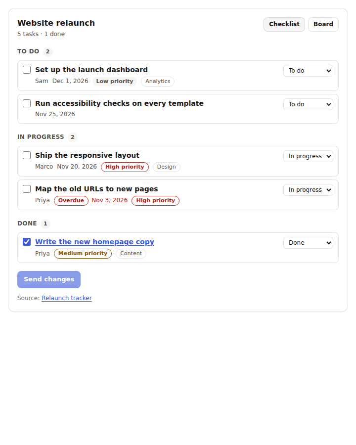

# Inkview

Agent-agnostic UI components for [MCP Apps](https://github.com/modelcontextprotocol/ext-apps).
Your agent already has the data; Inkview draws it as a native-looking component
right in the chat, in Claude, ChatGPT and any other host that renders MCP Apps.


## Install

### Claude Code and Claude Desktop: plugin

Installs the server and a short Skill that tells Claude when to use each component:

```text
/plugin marketplace add feimacode/inkview
/plugin install inkview@inkview
```

### Any local MCP client: npx

Claude Desktop, Claude Code, Codex, Cursor and VS Code start Inkview over stdio:

```json
{ "mcpServers": { "inkview": { "command": "npx", "args": ["-y", "@feimacode/inkview"] } } }
```

Hosts that support MCP Apps (Claude Desktop) draw the component; text-only
clients (Claude Code, Codex) print its markdown version. Each release also has a
`.mcpb` desktop extension for one-click install in Claude Desktop. Setup for
each app: **[docs/local-quickstart.md](docs/local-quickstart.md)**.

### Claude web and ChatGPT web: remote URL

These connect from the cloud, so they need an HTTPS URL ending in `/mcp`: the
hosted server (coming with the public launch), your own deployment
([self-hosting](docs/self-hosting.md), Docker included), or for a quick test
`npm run dev` plus a tunnel ([guide](docs/testing-in-claude-and-chatgpt.md)).
ChatGPT app setup: [docs/chatgpt-app.md](docs/chatgpt-app.md). What the hosted
server does with your data: [docs/privacy.md](docs/privacy.md).

### From source

```bash
npm install            # also builds
node dist/inkview.js   # stdio
npm run dev            # HTTP on http://localhost:3001/mcp
npm run preview        # gallery of every component, light and dark, at http://localhost:5174
```

## Components

| Tool | Draws | Try asking |
| --- | --- | --- |
| `show_profile_card` | A person: avatar, role, tags, links. Shortlist, open profile, draft outreach | "Find Ada Lovelace and show her profile card" |
| `show_profiles` | 2 to 24 people as a responsive grid of compact cards. Select several to ask about, add to a shortlist, expand one into the full profile | "Who is speaking at AI Summit 2026? Show me the speakers" |
| `show_timeline` | Up to 50 dated events on a vertical timeline. Expand details, filter categories, reverse order, open links or ask about an event | "Show Northstar's company history as a timeline" |
| `show_tasks` | Up to 50 tasks with a status, as a grouped checklist or a board. Check items off, move them between statuses, send the changes back. Overdue and priority cues | "Show the website relaunch tasks as a checklist" |
| `show_table` | Up to 50 typed rows (text, number, money, date, link, badge). Sort, filter, select rows to ask about, CSV download | "Show the 10 largest EU cities by population as a table" |
| `show_results` | Up to 20 search results or sources with snippets. Open, dig deeper | "Search for MCP Apps docs and show the results" |
| `show_entity_card` | A company, product, place or organization: facts and links. Open website, compare | "Show me a card for Stripe" |
| `show_comparison` | 2 to 5 options side by side, with an optional recommendation. Choose this | "Compare Notion, Obsidian and Apple Notes for a small team" |
| `show_chart` | Line or bar chart, up to 5 series. Tooltips, legend toggles, text summary for screen readers | "Chart our monthly signups for this year" |
| `show_products` | Up to 12 products with price, rating and availability. Sort, view at store, compare (no cart) | "Find noise-cancelling headphones under $300" |
| `show_auto` | Any JSON: picks the best component above, or formatted text | (fallback when the shape is unclear) |

<p>









</p>

### How `show_auto` picks a component

It looks at the data's shape, in this order, and the first match wins:

1. **Product grid**: an array of items with a title or name, a URL and a price.
2. **Result list**: an array of items with a title or name and a URL.
3. **Chart**: rows of a date or label plus numeric columns (`[{month, users}]`), a `label → number` map (`{Mon: 3, Tue: 5}`), or `{x, series}`.
4. **Profile card**: one person: a name plus a role (`title`, `jobTitle`, `role`) or person fields (`firstName`, `linkedin`).
5. **Entity card**: one organization or place: a name plus org fields such as `website`, `industry`, `founded`, `headquarters`, `address` or `type`.
6. **Data table**: an array of same-shaped records (first 50 rows kept).

Wrappers like `{results: [...]}`, `{products: [...]}` and `{rows: [...]}` are unwrapped first.
A `hint` (`"table"`, `"chart"`...) overrides detection when the data fits that
component. Anything else is shown as formatted text. The text result names the
explicit tool, so the model can call it directly next time.

## How it works

Inkview is an MCP server of *render tools*. The agent gathers data with its own
tools (search, LinkedIn, CRM...), then calls a render tool such as `show_table` or `show_profile_card` with it. The
server validates the data and returns:

- `structuredContent` for the UI, which the host draws from the tool's `ui://` resource in a sandboxed iframe
- a markdown version of the same view, for the model and for text-only hosts (Claude Code, Codex CLI)

The server is stateless: it stores nothing and never logs tool arguments.

| Piece | Where |
| --- | --- |
| One folder per component: `meta.ts`, `schema.ts`, `markdown.ts`, `View.tsx`, `examples.json` | `src/components/<name>/` |
| Render tools + the shared `ui://inkview/v1/app.html` resource | `src/server.ts` |
| HTTP (`/mcp`) and stdio entry point | `src/main.ts` |
| Shared view runtime (MCP Apps bridge, theming, states) | `src/runtime/` |
| Dev host, preview gallery, render checks | `dev/`, `scripts/` |

The server ships as one dependency-free file (`dist/inkview.js`, view HTML
inlined), so a cold `npx` start takes about a second.

## Test

```bash
npm test     # build, bundle size budget, MCP smoke tests (HTTP and stdio), hosting limits, unit tests, render checks
```

Render checks draw every example in light, dark and 320 px, and check contrast,
keyboard focus and each component's actions. They need Playwright's Chromium
(`npx playwright install chromium`). Screenshots land in `dist-test/`.
See [CONTRIBUTING.md](CONTRIBUTING.md).

## Configuration

| Variable | Default | Purpose |
| --- | --- | --- |
| `PORT` | `3001` | HTTP port |
| `HOST` | `127.0.0.1` | Bind address (use `0.0.0.0` in a container) |
| `INKVIEW_IMAGE_DOMAINS` | | Extra avatar image origins for the component CSP, comma separated |
| `INKVIEW_UI_DOMAIN` | | Dedicated sandbox origin, if a host asks for one |

HTTP mode also has a body limit, per-IP rate limit and a metadata-only access log;
see [docs/self-hosting.md](docs/self-hosting.md) for those settings.

Avatars only load from origins declared in the CSP (GitHub, LinkedIn media,
Gravatar, unavatar.io, Wikimedia, Unsplash, X/Twitter images by default).
Anything else falls back to initials.

## Evals

`npm run evals` measures whether models pick the right component and avoid
inventing values (needs an Anthropic API key). See [evals/README.md](evals/README.md).

## Roadmap

The MVP is planned as OpenSpec changes: see [docs/roadmap.md](docs/roadmap.md) and [`openspec/`](openspec).

## License

MIT
